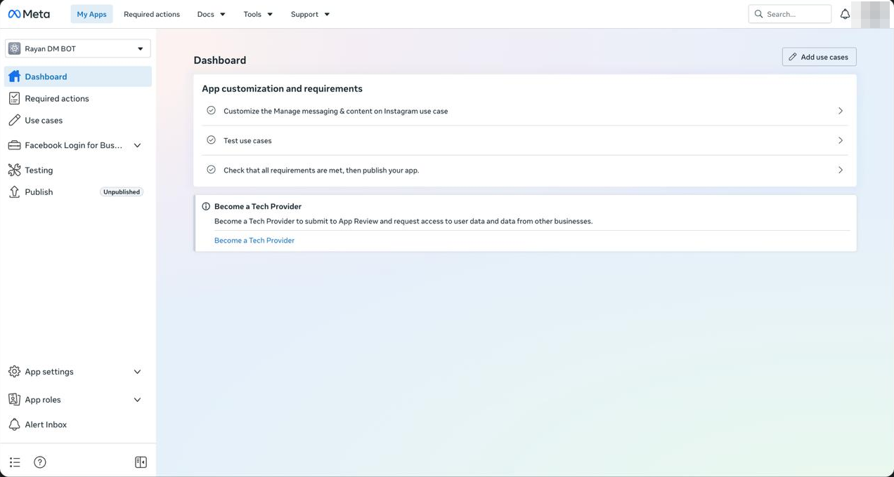
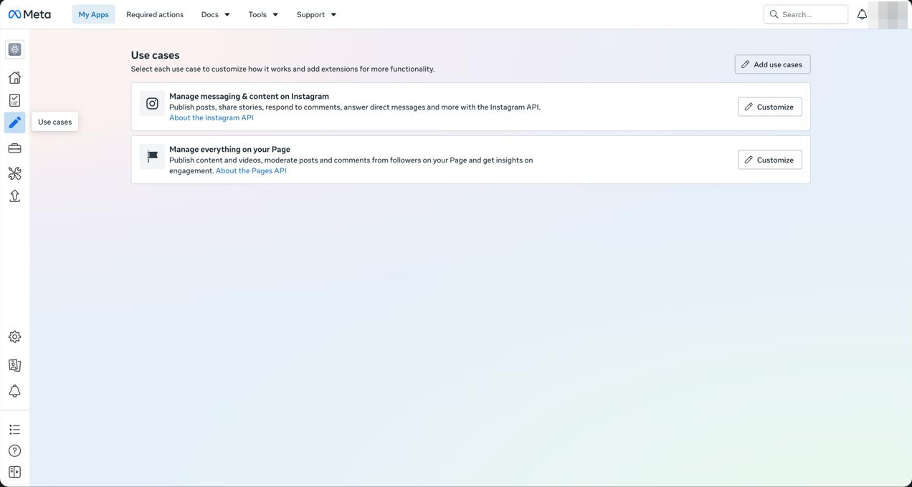
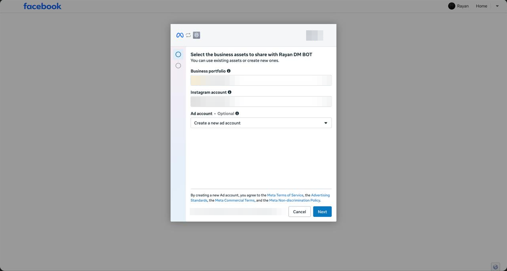
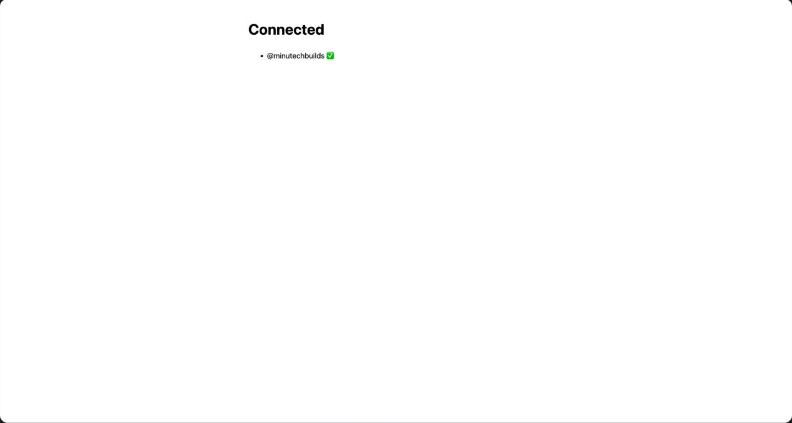
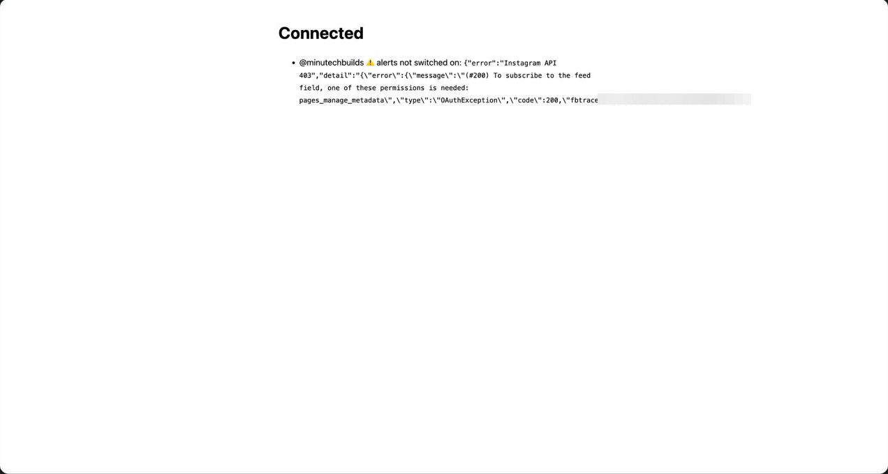
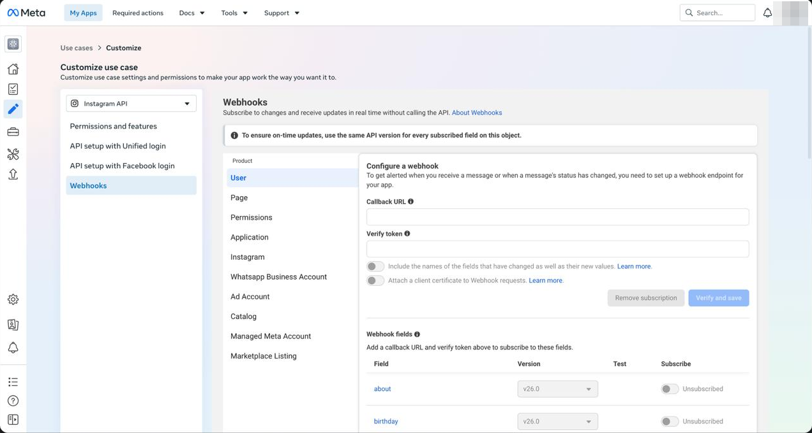
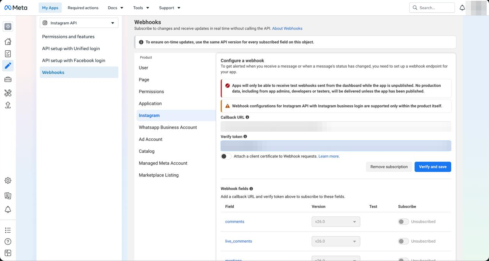
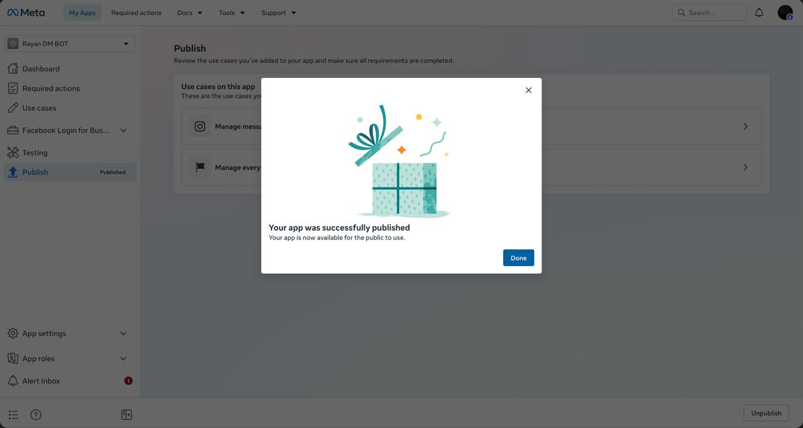
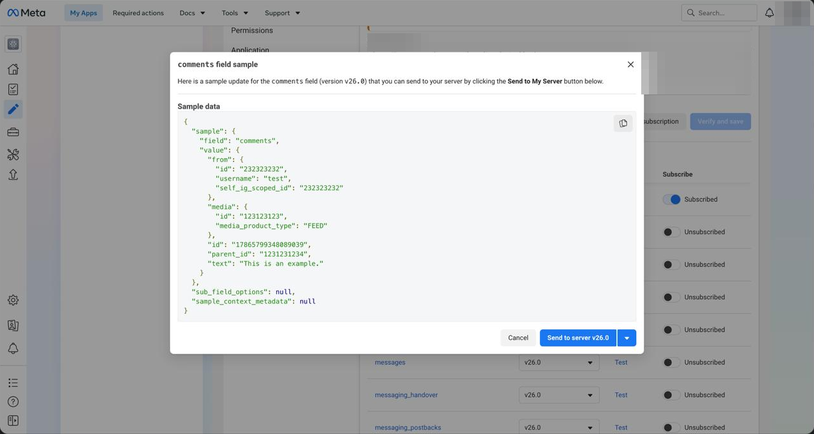

# Setup guide

About 30 minutes, all free. Meta's dashboard is a maze, so every step has a screenshot,
and every trap we fell into is in [TROUBLESHOOTING.md](TROUBLESHOOTING.md).

> Using an AI agent? Point it at [`skills/instagram-comment-dm/SKILL.md`](../skills/instagram-comment-dm/SKILL.md)
> and it will walk you through this one step at a time.

Throughout, `<WORKER_URL>` means your bot's address, e.g. `https://openchat.yourname.workers.dev`.

## What you need

- An Instagram **Professional** account (Creator or Business), set to **public**.
- A **Facebook Page** linked to that Instagram account
  (Instagram → Settings → Accounts Centre). A free, empty Page is fine.
- A free [Cloudflare](https://dash.cloudflare.com/sign-up) account and Node.js 20+.
- A second Instagram account (or a friend) for the final test. You can't DM yourself.

## 1. Put the bot online

```bash
git clone <this repo> && cd openchat
npm install
npx wrangler login                      # opens the browser once
npx wrangler kv namespace create STATE  # copy the id it prints
```

Paste the KV id into `wrangler.toml` (`REPLACE_WITH_KV_ID`), then:

```bash
npm run deploy
```

Wrangler prints your `<WORKER_URL>`. Opening it should say `openchat is running`.

## 2. Create the Meta app

developers.facebook.com → **My Apps** → **Create app**.

- Use case: **Manage messaging & content on Instagram**.
- Skip the business portfolio if it asks.



## 3. Add the Page use case

Dashboard → **Add use cases** → **Manage everything on your Page**.

The bot needs the `pages_manage_metadata` permission to switch on comment alerts, and it only
comes with this use case. Without it you'll hit [trap 3](TROUBLESHOOTING.md#3-invalid-scopes-pages_manage_metadata).



## 4. Basic settings

**App settings → Basic**:

| Field | Value |
| --- | --- |
| App domains | your worker host, e.g. `openchat.yourname.workers.dev` |
| Privacy policy URL | `<WORKER_URL>/privacy` (the bot serves this page) |

Save. While you're here, copy the **App ID** and the **App secret** (click Show).

## 5. Give the bot its settings

In `wrangler.toml`, set `META_APP_ID` to your App ID. Then set two secrets:

```bash
npx wrangler secret put IG_APP_SECRET   # paste the App secret
npx wrangler secret put VERIFY_TOKEN    # paste any long random string, and keep it handy
npm run deploy
```

`VERIFY_TOKEN` does two jobs: Meta uses it to check your webhook, and it locks the bot's
setup pages so nobody else can use them.

## 6. Connect your Instagram

Open this in your browser:

```
<WORKER_URL>/connect?key=<VERIFY_TOKEN>
```

Facebook asks you to log in and pick what to share. Pick your **business portfolio**, your
**Instagram account** and the **Facebook Page** linked to it.



If it insists on "Create a new ad account", let it. It's free, stays empty and is never charged.

You should land on this:



The bot has now saved a Page token for itself (it doesn't expire) and switched on comment
alerts for your Page. You never copy a token by hand.

If you see "⚠️ alerts not switched on" instead, you skipped step 3:



## 7. Point Meta's webhook at the bot

**Use cases → Customize** (the Instagram one) → **Add more to this use case** →
**+ Add** next to *Get real-time notifications with Webhooks*.

On the Webhooks page, pick **Instagram** in the Product column. It opens on **User**, which is
the wrong one.



- Callback URL: `<WORKER_URL>/webhook`
- Verify token: your `VERIFY_TOKEN`
- **Verify and save**
- Find **comments** in the fields list and switch **Subscribe** on.



## 8. Publish

Left sidebar → **Publish**. Until the app is published, Meta only sends the fake test
webhooks from the dashboard (see the red box in the screenshot above).



## 9. Test

**Pipe test:** on the Webhooks page, click **Test** next to *comments* → **Send to server**.
Watch it arrive with:

```bash
npx wrangler tail
```

You should see `webhook received 1 comment(s)`. The sample text is "This is an example.",
so it won't trigger a DM; it just proves Meta can reach your bot.



**Real test:** from a *different* Instagram account, comment your keyword on one of your
posts. Within seconds that account gets the DM, and a "Check your DMs 📩" reply appears
under the comment.

## Changing keywords

Edit [`src/rules.ts`](../src/rules.ts), then `npm run deploy`. Each rule has keywords, the DM
text, optional public replies and an optional list of post IDs to limit it to.

## Checking what the bot can see

`<WORKER_URL>/setup?key=<VERIFY_TOKEN>&debug=1` shows what Meta lets the bot access
(without showing the token). `<WORKER_URL>/setup?key=<VERIFY_TOKEN>` switches comment
alerts on again.
