# Traps we hit (so you don't have to)

We set this up for real in October 2026. Meta's docs, most YouTube tutorials and
Meta's own dashboard didn't agree with each other. Here's everything that went wrong and
the fix.

## 1. "API setup with Instagram login" doesn't exist any more

Most guides say to use **Instagram login** (the simplest route, no Facebook Page needed).
New apps don't get it. The dashboard says so in a small banner and only offers
**Unified login** and **Facebook login**.

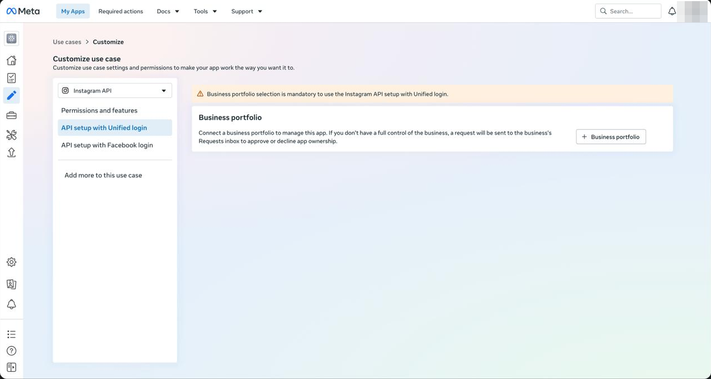

**Fix:** use Facebook login, as in [SETUP.md](SETUP.md). (If your older app still has
Instagram login, set `IG_LOGIN = "instagram"` in `wrangler.toml`; the code supports it.)

## 2. Unified login gives you a token that can't see your Instagram

Unified login looks like the recommended path. It needs a business portfolio, and its token
"never expires".

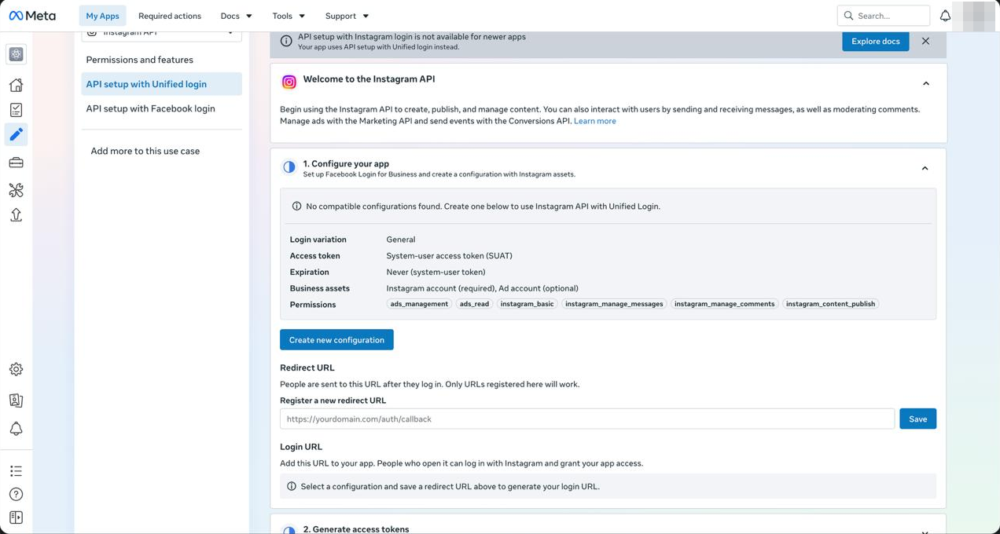

But after connecting, the token sees **no Instagram accounts**: `assigned_instagram_accounts`
returns `[]` and looking up your account ID fails with error 100 / subcode 33. That happens
even though the account is in your portfolio, shared during login and accepted as a tester.

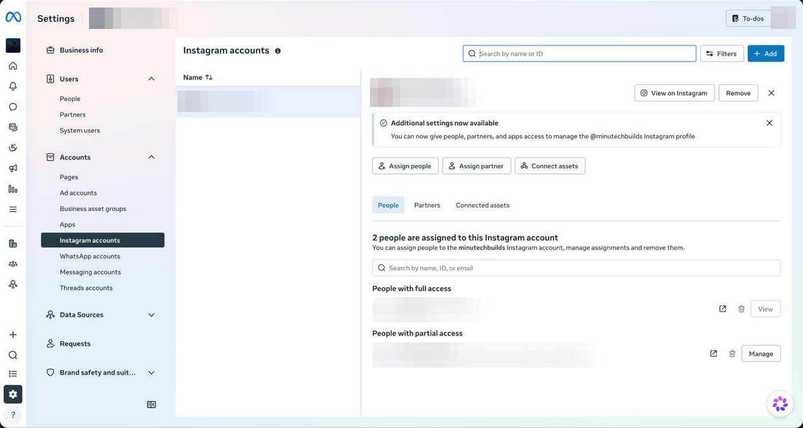

The **Generate token** button on that page gives a hidden "system user" token, and your
portfolio's System users page stays empty, so there's nothing to assign by hand either.

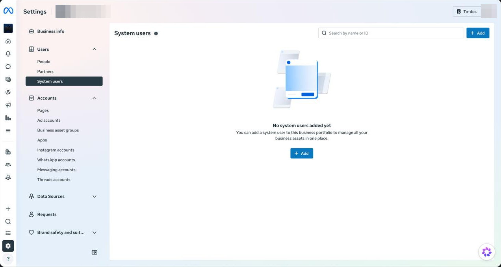

This is a known Meta problem. Several developers reported it on Meta's developer forum the
same week ([1](https://developers.facebook.com/community/threads/1831238961211204/),
[2](https://developers.facebook.com/community/threads/2163351674258743/)), and there was no fix.

**Fix:** skip Unified login. Use Facebook login with a linked Facebook Page.

## 3. "Invalid Scopes: pages_manage_metadata"

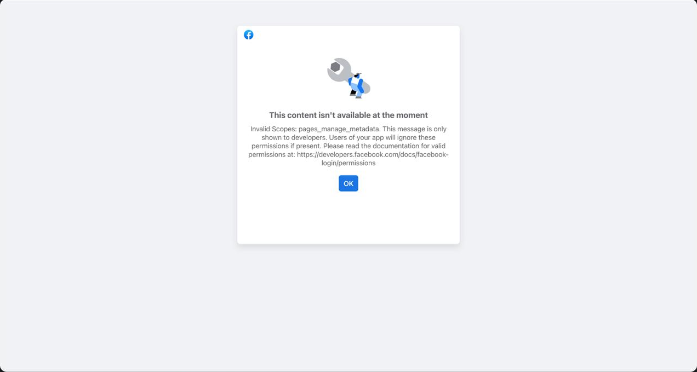

The Instagram use case doesn't include the Page permission that switches on comment alerts,
and it isn't in its Permissions list either.

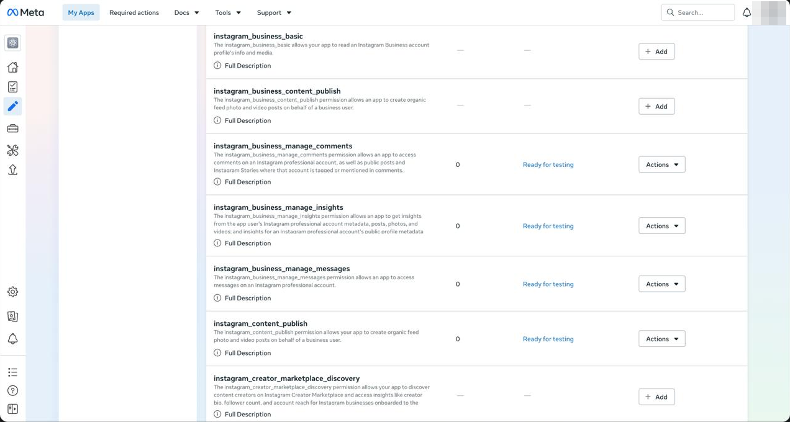

**Fix:** Dashboard → **Add use cases** → **Manage everything on your Page**.

## 4. "Can't load URL: the domain of this URL isn't included in the app's domains"

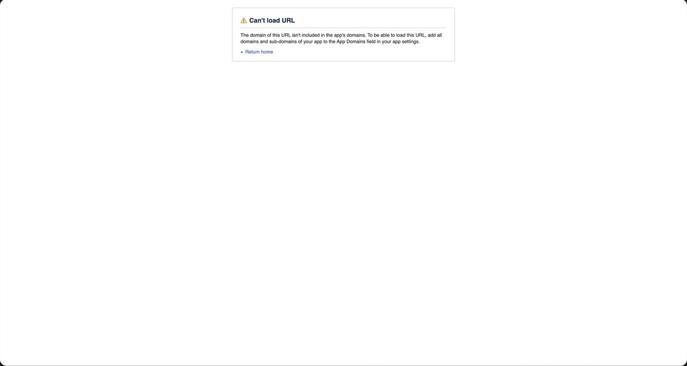

**Fix:** App settings → Basic → **App domains** → add your worker host
(`openchat.yourname.workers.dev`).

## 5. Connected, but "alerts not switched on"

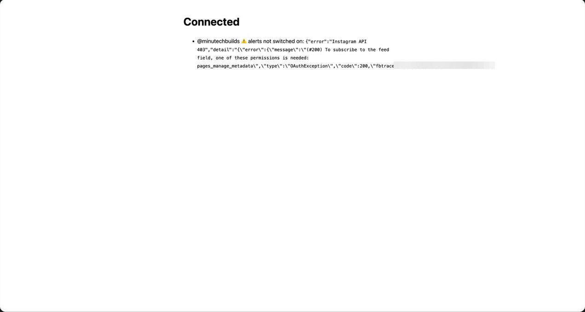

Same root cause as trap 3: no `pages_manage_metadata`. Add the Page use case, then open
`/connect` again.

## 6. The Webhooks page opens on the wrong product

It defaults to **User**. Instagram comments are under **Instagram** in the Product column.

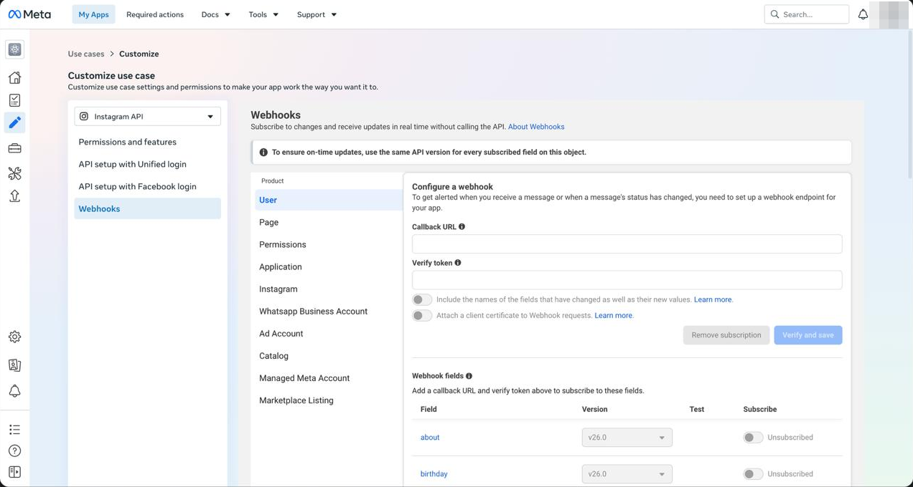

Also, the "Configure webhooks" line on the Facebook login page is only a link to docs.
The real settings are under **Add more to this use case → Webhooks**.

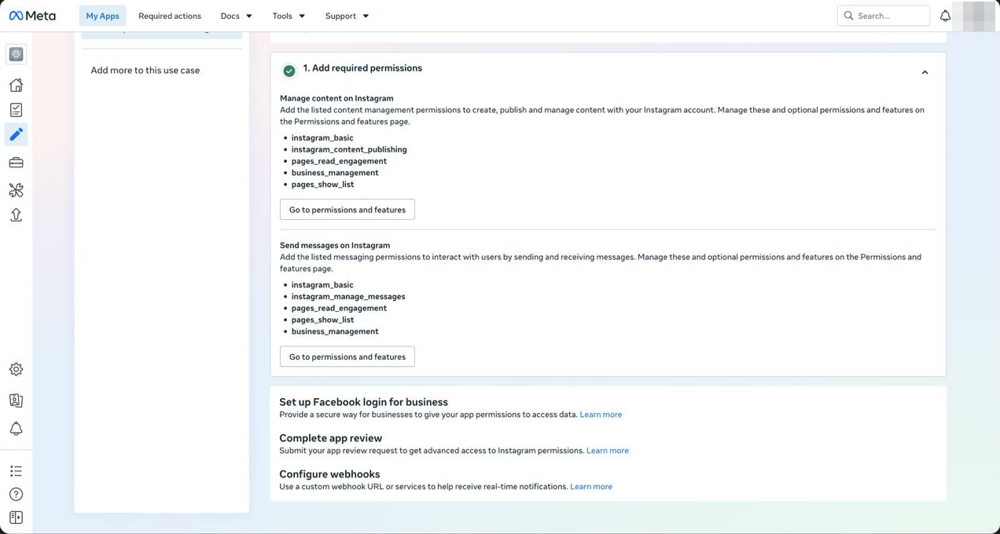

## 7. No webhooks arrive

Until the app is **published**, Meta only delivers the fake test webhooks from the
dashboard, even for your own account. Publish it (left sidebar → Publish).

## 8. "Allow access to messages" isn't where older docs say

It moved. In the Instagram app: profile → ☰ Menu → **Messages and story replies** →
**Message requests** → under *Connected tools*, turn on **Allow access to messages**.
(Older guides point to a "Message controls" menu that no longer exists.)

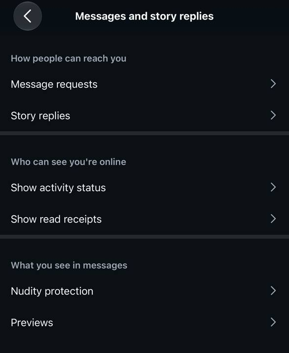

## 9. "Create a new ad account" is forced on you

The login popup's Ad account field is optional, but sometimes the only choice is
"Create a new ad account". It's harmless: free, empty, and never charged unless you run ads.

## 10. You can't test with your own account

The bot ignores your own comments, and Instagram won't let you DM yourself. Use a second
account or ask a friend. To check the pipe without a second account, use the **Test** button
on the Webhooks page ([SETUP.md step 9](SETUP.md#9-test)).

## 11. Meta doesn't send every comment

In our tests one comment arrived by webhook and the next one never did. The bot has a safety
net for this: every 5 minutes it checks the comment counts on your 25 latest posts, reads the
posts that changed, and answers any keyword comment it hasn't answered yet. It only looks at
comments made after the bot's first run, so people who commented earlier aren't messaged out of
the blue. To run it by hand: `<WORKER_URL>/setup?key=<VERIFY_TOKEN>&catchup=1`.

## 12. "The app is not connected to the business" (error subcode 2534039)

We hit this when sending the DM through the Instagram account's own messages edge
(`/<IG_ID>/messages`) with a Facebook Page token. With the Facebook-login setup the DM has to go
through the Page instead (`/me/messages` with the Page token). The bot does this when
`IG_LOGIN = "facebook"`, so you shouldn't see it; if you do, check that you're on the latest code
and that "Allow access to messages" (trap 8) is on.

## Still stuck?

- `npx wrangler tail` shows every webhook and every error, live.
- `<WORKER_URL>/setup?key=<VERIFY_TOKEN>&debug=1` shows what Meta lets the bot see.
- Open an issue with what you see (never paste tokens or secrets).
